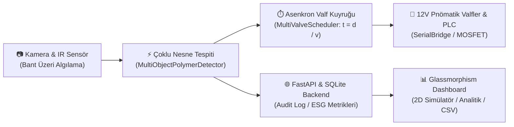

# sıfır-atık-yapay-zeka (sifir-atik-yapay-zeka)

<div align="center">
  
  
  <p align="center">
    <strong>Düşük Maliyetli, Uçta Yapay Zeka (Edge-AI) Destekli ve Açık Kaynaklı Polimer Ayrıştırma Ekosistemi</strong>
  </p>

  <p align="center">
    <a href="#-temel-özellikler"></a>
    <a href="#-sistem-mimarisi"></a>
    <a href="#-benchmark-ve-performans"></a>
    <a href="#-çevresel-etki-esg"></a>
    <a href="LICENSE"></a>
  </p>
</div>

---

Geri dönüşüm endüstrisinin en kritik darboğazı, atıkların doğru, yüksek hızlı ve sürdürülebilir bir maliyetle ayrıştırılmasıdır. Bu depo (repo); **PET, HDPE, Naylon (Poliamid), PUR, Metal** gibi farklı polimer ve malzemeleri standart kameralar, temel optik/endüktif sensörler ve uçta yapay zeka (Edge-AI) algoritmalarıyla milisaniyeler içinde sınıflandırıp pnömatik solenoid valflerle ayıran bir cihazın uçtan uca mimarisini ve kaynak kodlarını sunar.

---

## 🌍 Sektör Liderleri ve Bu Projenin Konumu

Dünyadaki endüstriyel devlerin yaklaşımları:
* **TOMRA (Norveç):** Yakın Kızılötesi (NIR) Spektroskopisi kullanır. %99 doğruluk sunar ancak **yüz binlerce dolarlık** kurulum maliyeti gerektirir.
* **AMP Robotics (ABD):** Bilgisayarlı görü ve yüksek hızlı delta robot kollar kullanır. Büyük tesisler için tasarlanmıştır.
* **Glacier (ABD):** Düşük maliyetli robotik vizyonu hedefler.

> **🎯 `sifir-atik-yapay-zeka` Projesinin Doldurduğu Boşluk:**
> Pahalı NIR spektrometreleri veya yüz bin dolarlık robot kollara ihtiyaç duymadan; **Raspberry Pi / Jetson Nano**, optimize edilmiş **TinyML modelleri (PolymerEdgeNet / MultiObjectDetector)**, **Arduino/PLC seri haberleşme köprüsü** ve **hızlı pnömatik valflerle** yerel tesislerin, üniversitelerin ve bağımsız geliştiricilerin kurabileceği **erişilebilir ve ölçeklenebilir açık kaynaklı bir altyapı** sunmaktır.

---

## 🔬 Hedeflenen Polimerler ve Algılama Yöntemleri

| Polimer / Atık Türü | Geri Dönüşüm Kodu | Yoğunluk | Ayırt Etme Yöntemi | Ayrıştırma Aktüatörü |
| :--- | :---: | :---: | :--- | :--- |
| **PET (Polietilen Tereftalat)** | ♳ (#1) | 1.38 g/cm³ | Optik Saydamlık + Spektral Yansıma | Pnömatik Valf 1 |
| **HDPE (Yüksek Yoğunluklu PE)** | ♲ (#2) | 0.95 g/cm³ | Renk / Yüzey Dokusu + Form Sınıflandırıcı | Pnömatik Valf 2 |
| **Naylon (Poliamid PA6/PA66)** | ♸ (#7) | 1.14 g/cm³ | Termal Davranış / Yansıma Analizi | Pnömatik Valf 3 |
| **PUR (Poliüretan Köpük)** | ♸ (#7) | 0.03 g/cm³ | Esneklik / Doku Analizi + Hacimsel CNN | Pnömatik Valf 4 |
| **Metal (Alüminyum / Teneke)** | ♶ (#41) | 2.70 g/cm³ | Endüktif Yaklaşım Sensörü + Spekular Yansıma | Pnömatik Valf 5 |
| **Reject (Bilinmeyen/Kompozit)** | ♸ (#0) | - | Güven Skoru Eşik Altı (<%75) | Bant Sonu Haznesi |

---

## 🏗️ Sistem Mimarisi ve Veri Akışı



1. **Algılama (Sensing):** Atıklar konveyör banda girer; kamera ve IR sensörler banttan geçişi saptar.
2. **Çıkarım ve Takip (Multi-Object Tracking):** `MultiObjectPolymerDetector` aynı anda akan birden fazla atığı tespit edip her birine benzersiz bir `track_id` atar.
3. **Zamanlanmış Valf Kuyruğu (Multi-Valve Scheduler):** Her atığın polimer türüne ait valf mesafesine ($d$) göre varış süresi ($t = d / v$) hesaplanarak asenkron heap kuyruğunda zamanlanır.
4. **Endüstriyel Köprü (Industrial Bridge):** `SerialBridge` veya GPIO HAL üzerinden valfler mikrosaniyeler içinde tetiklenir.
5. **Telemetri ve ESG (Environmental Impact):** EPA WARM katsayılarıyla kurtarılan kütle ($kg$), engellenen $CO_2$ ($kg$) ve enerji ($kWh$) hesaplanıp dashboard'da canlı sunulur.

---

## ⚡ Benchmark ve Performans Sonuçları

Model, x86 ve ARM64 CPU mimarilerinde kapsamlı benchmark testinden geçirilmiştir (`yapay-zeka/benchmark.py`):

```text
============================================================
Sıfır Atık YZ - Model Çıkarım Benchmark Testi
============================================================
Yüklenen Model: PolymerEdgeNet (TorchScript JIT Optimize)
Örnek Giriş Boyutu: (1, 3, 224, 224) RGB

Ortalama Gecikme (Latency): 2.70 ms
Medyan Gecikme:            2.64 ms
P95 Gecikme:               3.39 ms
P99 Gecikme:               3.56 ms
Min / Max:                 2.15 ms / 3.61 ms
Teorik Çıkarım Hızı:       370.2 FPS
============================================================
```

---

## 📁 Depo Dizin Yapısı

```text
├── arayuz/                      # Web Dashboard ve Kontrol Merkezi
│   ├── index.html               # 7 Sekmeli Modern SPA Arayüzü (ESG, Simülatör, Kamera)
│   ├── style.css                # CSS3 Değişkenleri, Glassmorphism ve Responsive Düzen
│   ├── app.js                   # WebSocket İstemcisi, Chart.js ve 2D Canvas Simülatörü
│   └── backend/                 # FastAPI REST API ve WebSocket Sunucusu
│       ├── main.py              # MJPEG Kamera Streamer, REST Uçları ve WebSocket Dağıtıcısı
│       ├── database.py          # SQLite Veri Tabanı Katmanı (Audit Log ve ESG Raporlama)
│       └── requirements.txt     # Python Paket Gereksinimleri
├── gomulu-yazilim/              # Uç Donanım ve Aktüatör Sürücüleri
│   ├── edge_inference.py        # Canlı Kamera + AI Modeli + Valf Entegrasyon Motoru
│   ├── multi_object_tracker.py  # Çoklu Atık Takipçisi ve Asenkron Valf Kuyruğu
│   ├── serial_bridge.py         # Arduino/STM32/PLC Seri ASCII Protokol Köprüsü
│   ├── actuator_controller.py   # Donanım Soyutlama Katmanı (HAL) ve Valf Sürücüsü
│   ├── conveyor_tracker.py      # Bant Hızı ve Gecikme (t = d / v) Zamanlayıcısı
│   ├── sensor_reader.py         # IR Optik, Endüktif ve Spektrometre Sensör Okuyucusu
│   └── servo_control.py         # MG996R Mekanik Flap Açı Kontrolü
├── yapay-zeka/                  # Model Eğitimi, Mimari ve Veri Seti Araçları
│   ├── modeller/
│   │   ├── yolo_detector.py     # Çoklu Nesne Tespiti ve Centroid Takip Motoru
│   │   ├── model_arch.py        # PolymerEdgeNet PyTorch CNN Mimarisi
│   │   ├── classes.json         # Polimer Özellikleri ve Spektral Parametreler
│   │   ├── dataset.yaml         # YOLOv8 Veri Kümesi Yapılandırma Dosyası
│   │   └── polymer_model_scripted.pt # Optimize Edilmiş TorchScript Modeli
│   ├── egitim/
│   │   └── train_classifier.py  # Model Eğitim Pipeline'ı ve İhraç Araçları
│   ├── veri-toplama/
│   │   ├── kamera_okuma.py      # Hareket Algılamalı Otonom Veri Toplayıcı
│   │   └── yolo_format_donusturucu.py # Ham Veriyi YOLO Formatına Çevirici
│   └── benchmark.py             # FPS, Latency ve Donanım Yükü Ölçüm Scripti
├── donanim/                     # Mekanik Çizimler ve Devre Şemaları
│   ├── mekanik/
│   │   ├── servo_flap_braketi.scad      # 2020 Alüminyum Profil Servo Braketi
│   │   ├── kamera_montaj_aparati.scad   # Ayarlanabilir Kamera Taşıyıcı Braket
│   │   ├── pnomatik_manifold_montaj.scad# 5'li Solenoid Manifold Montaj Ayağı
│   │   └── konveyor_gergi_aparati.scad  # 608zz Rulmanlı Bant Gergi Parçası
│   └── elektronik/
│       ├── baglanti_semasi.md           # Detaylı Pinout ve Güvenlik/Diyot Bağlantıları
│       ├── plc_ve_arduino_baglantisi.md # Endüstriyel PLC ve Mikrodenetleyici Seri Bağlantı
│       └── devre_semasi.svg             # Vektörel Elektriksel Bağlantı Blok Şeması
├── dokumantasyon/               # Mühendislik Kılavuzları
│   ├── BOM.md                   # 2026 Güncel Malzeme Listesi ve Maliyet Tablosu
│   ├── KURULUM.md               # Raspberry Pi / Jetson Kurulumu ve systemd Servisleri
│   ├── KALIBRASYON_VE_TEST.md   # Konveyör Bant Hız ve Valf Zamanlama Kalibrasyonu
│   └── CEVRESEL_ETKI_METODOLOJISI.md # EPA WARM Tabanlı Karbon ve Enerji Hesaplama Modeli
├── tests/                       # Otomatik Pytest Birim ve Entegrasyon Testleri (16 Test)
│   ├── test_backend_api.py
│   ├── test_actuators.py
│   ├── test_inference.py
│   ├── test_multi_tracker.py
│   ├── test_environmental.py
│   ├── test_serial_bridge.py
│   └── test_yolo_detector.py
├── Dockerfile                   # Konteyner İmajı
├── docker-compose.yml           # Tek Komutla Dağıtım
└── .github/workflows/ci.yml     # Sürekli Entegrasyon (CI Pipeline)
```

---

## 🚀 Hızlı Başlangıç

### 1. Depoyu İndirin ve Bağımlılıkları Kurun
```bash
git clone https://github.com/bahattinyunus/sifir-atik-yapay-zeka.git
cd sifir-atik-yapay-zeka

pip install -r arayuz/backend/requirements.txt
pip install torch pytest
```

### 2. Backend Sunucusunu ve Canlı Akışı Başlatın
```bash
cd arayuz/backend
python -m uvicorn main:app --host 0.0.0.0 --port 8000 --reload
```
* Tarayıcınızda `http://localhost:8000/docs` adresinden Swagger API dokümantasyonuna ulaşabilirsiniz.
* `arayuz/index.html` dosyasını açarak canlı kontrol merkezini, 2D bant simülatörünü ve ESG çevresel etki panelini kullanmaya başlayın.

### 3. Edge AI Çıkarım Motorunu Çalıştırın
Ayrı bir terminal penceresinde:
```bash
cd gomulu-yazilim
python edge_inference.py
```

### 4. Testleri Koşturun
```bash
pytest tests/
```

---

## 🛠️ Docker ile Dağıtım

Tüm sistemi tek komutla ayağa kaldırmak için:
```bash
docker compose up --build
```

---

## 🤝 Katkıda Bulunma

1. Depoyu çatallayın (Fork).
2. Yeni bir özellik dalı açın (`git checkout -b ozellik/yeni-algoritma`).
3. Değişikliklerinizi commit edin (`git commit -m 'feat: yeni ozellik eklendi'`).
4. Dalınızı gönderin (`git push origin ozellik/yeni-algoritma`).
5. Bir Çekme İsteği (Pull Request) oluşturun.

---

## 📄 Lisans

Bu proje [MIT Lisansı](LICENSE) kapsamında açık kaynak olarak paylaşılmıştır. Ticari ve bireysel kullanım serbesttir.
